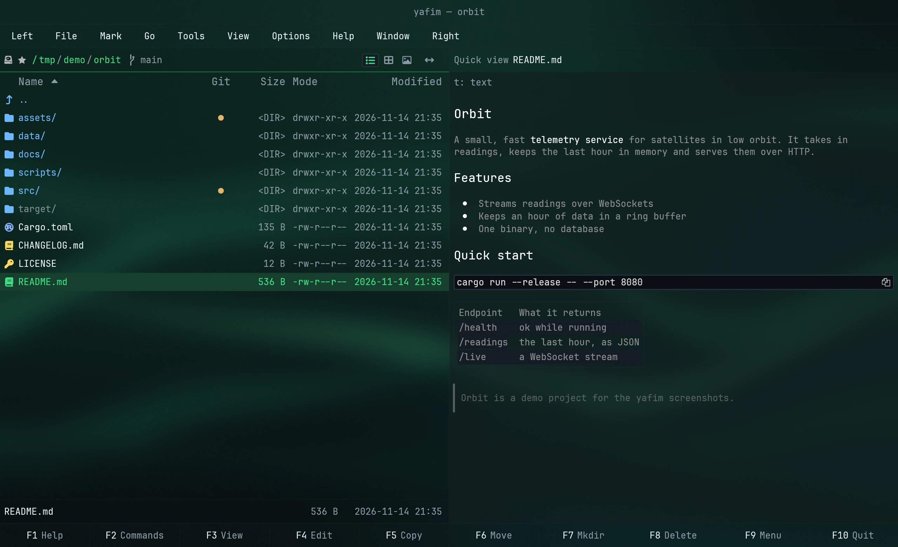

# yafim — Yet Another File Manager

A keyboard-first, two-panel file manager in the spirit of Midnight Commander, written in Rust
with [egui](https://github.com/emilk/egui). Two panels, a function-key bar and every command one
key away — with a real terminal in splits, a quick view that reads almost anything, servers and
cloud drives in a panel, and as many windows as you like, each with its own theme. For macOS,
Linux and Windows.



## Download

Get the latest version from **[Releases](https://github.com/ancane/yafim/releases/latest)**:

| System | File | Notes |
|---|---|---|
| macOS 11+ (Apple Silicon and Intel) | `yafim-X.Y.Z-macos-universal.dmg` | Or with Homebrew: `brew install --cask ancane/yafim/yafim` |
| Linux, 64-bit (glibc 2.35+: Ubuntu 22.04+, Debian 12+, Fedora 36+) | `.deb`, `.rpm` or `.tar.gz` | `sudo apt install ./yafim_*.deb` or `sudo dnf install ./yafim-*.rpm`; ffmpeg, offered with them, plays videos |
| Windows, 64-bit | `.zip` | Unpack anywhere and run `yafim.exe`; no installer |

**First launch.** The Mac app is signed ad hoc, not by Apple, so macOS asks once: right-click
the app › Open, or System Settings › Privacy & Security › Open Anyway. The Windows exe is not
signed, so SmartScreen asks once: More info › Run anyway.

**Updates.** yafim updates itself: once a day, if you allow it (Settings › Updates), it checks
this repository's latest release, whose list of files is signed, and offers **Update to …** in
the menu bar. Install and restart downloads the new version, checks it against the signed list
and restarts into it. Installs from a `.deb` or `.rpm` are updated by the package manager
instead.

**Privacy.** Nothing leaves your machine without asking. A crash leaves a report with no file,
folder, user or server names in it; the next start shows it to you and asks before sending it.

## What it does

- **Two panels** with tabs, marks, sorting, quick folders, folder history and a folder tree;
  thumbnails, a gallery of any folder and a wide panel when you want more on screen.
- **File operations that never lose data**: copy, move, Trash by default, conflicts that ask,
  copies that resume, checksums, Undo for moves, renames and the Trash, and instant clones on
  APFS.
- **A built-in terminal** with splits, which follows the panel's folder and opens paths it
  prints.
- **A quick view and a viewer** for text in colour, hex, pictures, PDFs, Markdown, tables,
  JSON and YAML trees, audio and video; files of any size open at once.
- **An editor** with a live Markdown preview, and a find bar with regular expressions.
- **Servers and cloud drives** in a panel: SSH and SFTP through your own `ssh`, FTP, network
  shares, WebDAV, S3 and every cloud drive [rclone](https://rclone.org) knows.
- **Git** in the panels: status marks, stage, commit, pull, push and three-way merges.
- **One search box** (⌘K) for folders, files, servers and commands; F9 for every command by
  menu.
- **Windows your way**: many windows or tabs of one, each with its own theme from 222, see-through
  and blurred.
- **Archives as folders**: zip, tar, 7z, RAR, ISO and packages, also on servers.

The full tour, with pictures of the real app, is on the website — `index.html` in this
repository.

## Keys

F1 opens the complete key reference inside the app. The everyday ones, as on a Mac (Ctrl in
place of ⌘ on Linux and Windows):

| | |
|---|---|
| F3 / F4 | View / edit |
| F5 / F6 / F7 / F8 | Copy / move / new folder / Trash |
| ⌘K | Search folders, files, servers and commands |
| F9 | Every command, by menu |
| ⌘O | Terminal |
| ⌘T / ⌘N | New tab / new window |
| ⌘Z | Undo a move, rename or Trash |

On a Mac, ⌘1…⌘9 stand in for F1…F9, which need the Fn key on most keyboards.

## Feedback

Found a bug or missing something? Open an [issue](https://github.com/ancane/yafim/issues).

## This repository

It holds yafim's releases and its website: `index.html` and the pictures in `img/`, taken from
the real app by its test suite. The app's source is developed in a separate repository. To look
at the website locally:

```sh
python3 -m http.server 8765
```

then open http://localhost:8765.
